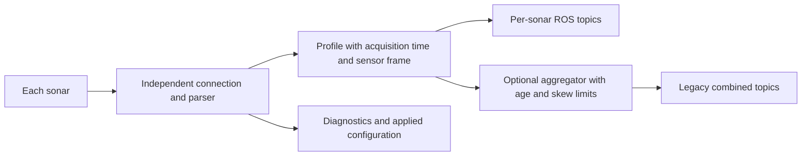

# Omniscan sidescan audit and modernization plan

The highest priorities are correct device configuration, acquisition timestamps,
and recovery of individual sonars. The current implementation can report a
successful configuration that a device rejected, stop publishing indefinitely
without triggering recovery, and combine measurements taken at different times
under one new timestamp. These behaviors affect survey accuracy and availability
regardless of implementation language.

Audited on 21 October 2026: branch `cam_wip`, commit
`f1ba326e7749cc3d237cb9b3484cb531c885ff66`. Validation used ROS 2 Lyrical,
Python 3.14.4, and an AMD Ryzen Threadripper 3970X workstation. Both packages
built in an isolated directory. All 38 pytest cases passed, along with the
message package lint checks; `colcon test-result` reported 44 tests and zero
failures, errors, or skips. Fault probes used local TCP simulators. Physical
sonar behavior, acoustic interference, and performance on the vehicle computer
remain hardware validation items.

**Priority convention.** P1 findings affect correctness or availability and
should precede deployment. P2 findings address robustness and integration.
P3 findings improve operation and maintenance. The findings distinguish
reproduced failures from features that would improve the architecture.

1. **P1: The speed of sound command uses the wrong protocol ID.**

   [definitions.py](../omniscan_sidescan/omniscan_sidescan/brping/definitions.py#L99)
   assigns `1002` to `OMNISCAN450_SET_SPEED_OF_SOUND`. Both the
   [Cerulean API](https://docs.ceruleansonar.com/c/omniscan-450/application-programming-interface.md)
   and the current
   [Ping protocol definition](https://github.com/bluerobotics/ping-protocol/blob/master/src/definitions/omniscan450.json)
   assign `116`. A device implementing that API will not receive the intended
   command. This can leave its range calibration different from the requested
   speed of sound.

   The simulator imports the same local definitions and therefore accepts the
   same incorrect ID. A probe that rejected the command left the driver's
   requested speed at `1500000 mm/s` while profiles reported `1482000 mm/s`.
   Correct the ID, pin the protocol reference, and test outgoing bytes against
   an independent fixture. Confirm the resulting profile's `sos_dmps` on actual
   firmware, allowing for its coarser units.

2. **P1: Configuration success only means bytes were written; rejected settings can stop all output indefinitely.**

   [Control methods](../omniscan_sidescan/omniscan_sidescan/brping/omniscan450.py#L60)
   send commands without awaiting device confirmation.
   [set_parameters](../omniscan_sidescan/omniscan_sidescan/omniscan450_driver.py#L225)
   then updates its local cache. NACK packets encountered while waiting for
   profiles do not become configuration errors. Socket write errors are handled,
   but a device rejection cannot trigger the advertised rollback.

   Reproduced with one simulator rejecting a `7000 mm` scan: ROS returned
   success, one sonar used `7000 mm`, and the other remained at `5000 mm`.
   Twelve subsequent combined sets were dropped, while both channel failure
   counters stayed at zero. The
   [metadata mismatch path](../omniscan_sidescan/omniscan_sidescan/sonar_node.py#L351)
   returns without a timeout or recovery threshold, so the condition can persist.

   Track requested and confirmed configuration separately. Handle documented
   ACK/NACK responses and verify observable settings from returned profiles.
   Bound the transition period, expose the applied configuration, and recover
   or report failure when convergence does not occur. Multi-device hardware
   configuration needs explicit confirmation and rollback semantics; ROS
   parameter atomicity alone cannot provide them.

3. **P1: The parameter validation callback changes hardware and runtime state before ROS commits the update.**

   [_on_set_parameters](../omniscan_sidescan/omniscan_sidescan/sonar_node.py#L246)
   writes to sonars and changes cached `frame_id` and `read_timeout` inside an
   `add_on_set_parameters_callback`. ROS
   [parameter guidance](https://github.com/ros2/ros2_documentation/blob/rolling/source/ROS-Framework/About-Parameters.rst)
   requires this validation stage to avoid side effects because another
   callback can reject the update afterward.

   Reproduced by adding a later validator that vetoed the transaction: ROS kept
   `length_mm=5000` and `frame_id=sonar`, but both devices changed to `7000 mm`
   and the cached frame changed to the rejected value.

   Validate in the on-set callback. Use a post-set callback to queue accepted
   desired configuration for the connection worker, with diagnostics reporting
   confirmed application. Provide a configuration service or lifecycle
   transition when callers need confirmation from hardware before an operation
   is considered complete. A post-set callback cannot retroactively reject an
   already committed ROS parameter update.

4. **P1: Published timestamps describe publication time, and aggregation has no bound on measurement age or skew.**

   [read_and_publish](../omniscan_sidescan/omniscan_sidescan/sonar_node.py#L306)
   reads channels sequentially, then stamps the combined message with
   `get_clock().now()`. It checks geometry, but does not check acquisition age,
   relative timing, duplicate pings, or configuration generation.

   With a `120 ms` delay injected before the second read, the node published a
   pair whose synthetic acquisition timestamps differed by `106 ms`, with one
   fresh header stamp. Vehicle motion during that interval can distort the
   relationship between sonar data and navigation measurements.

   Timestamp each profile when received, retain the device timestamp, and
   define a clock mapping if acquisition time is reconstructed. Device
   timestamps are milliseconds since each device's own startup: direct
   subtraction across devices does not establish synchronization. Handle reboot
   and the roughly 49.7-day counter wrap. An optional aggregator should enforce
   a configured age/skew limit and preserve timing for each channel.

5. **P1: One unavailable sonar removes every channel from service, and serial waits delay ROS callbacks.**

   [Startup](../omniscan_sidescan/omniscan_sidescan/sonar_node.py#L142)
   requires every sonar to connect. At runtime, one failed read suppresses the
   complete set; a broken socket or exhausted failure counter terminates the
   process. The launch file then waits
   [30 seconds](../omniscan_sidescan/launch/sidescansonarall.launch.py#L73)
   before restarting all connections. This makes a single-channel outage a
   system outage, including in otherwise healthy channels.

   The read loop also services only one ROS callback after each acquisition
   cycle. Four silent simulators with `50 ms` timeouts took `201.7 ms` per
   cycle. At the default `500 ms` timeout, four serial waits can consume about
   two seconds before callback servicing. Ten such cycles plus the fixed
   respawn delay can produce roughly 50 seconds before reconnection is even
   attempted, excluding setup and cleanup.

   Give each device an independent connection state machine, bounded retry
   backoff, and health status. Keep acquisition separate from the ROS executor.
   Publish healthy channels independently, with an explicit policy for consumers
   requiring complete sets. Expose connection, handshake, and data deadlines
   separately. A lifecycle node can make configure, activate, stop, and cleanup
   predictable for launch and supervisory software; this is an architectural
   improvement rather than a requirement for every ROS node.

6. **P2: The driver does not configure the device synchronization supported by multi-sonar installations.**

   The vendored
   [message subset](../omniscan_sidescan/omniscan_sidescan/brping/definitions.py#L99)
   omits synchronization commands. Cerulean documents
   [SET_SYNC_CHANNEL_NUMBER, ID 170](https://docs.ceruleansonar.com/c/cerulean-ping-protocol/general-packet-definitions/set_sync_channel_number),
   with channel zero as master, sequential channel IDs, and a configured device
   count. Devices coordinate over UDP port `51201` on the same subnet.

   Expose synchronization configuration, validate unique IDs, confirm the
   settings, and include synchronization status in diagnostics. Verify behavior
   with the installed firmware and sonar arrangement. This addresses a missing
   capability relevant to interference and timing; acoustic performance was not
   measured by the simulator. Hardware synchronization also needs to be paired
   with a documented mapping to ROS time.

7. **P2: Combined messages discard channel metadata and make spatial interpretation difficult.**

   [SHARED_FIELDS](../omniscan_sidescan/omniscan_sidescan/sonar_node.py#L56)
   includes `channel_number` and `vehicle_heading_deg`, and
   [message construction](../omniscan_sidescan/omniscan_sidescan/sonar_node.py#L379)
   copies them exclusively from the first sonar. Channel numbers can deliberately
   differ in a synchronized installation. Each physical head also has its own
   mounting position and orientation, while the combined interface exposes one
   generic `sonar` frame.

   Introduce a profile message and topic for each sonar, with its own header,
   device/channel identity, acquisition time, and metadata. Define mounting
   transforms through the vehicle URDF or static TF configuration. Keep the
   existing pair/four-channel messages as an optional compatibility output.

   A normalized ROS interface should use meters, meters per second, radians,
   and documented coordinate conventions, following
   [REP 103](https://github.com/ros-infrastructure/rep/blob/master/rep-0103.rst).
   Wire-format messages can retain explicitly named device units. Changing the
   meaning or units of existing fields would break consumers and bag replay;
   introduce a versioned interface. A sonar return profile is not automatically
   a planar `LaserScan`; conversions must preserve the sensor's actual geometry.

8. **P2: A malformed length can consume subsequent valid profiles before the parser recovers.**

   [PingParser](../omniscan_sidescan/omniscan_sidescan/brping/pingmessage.py#L350)
   accepts the full 16-bit advertised payload length and waits for that many
   bytes before validating structure and checksum. It has no incomplete-frame
   deadline or early check against a known message's allowable length.

   Feeding a profile header advertising `65535` payload bytes followed by five
   valid maximum-size profiles produced zero parsed messages and zero reported
   errors; the parser still awaited `53225` payload bytes. Those valid profiles
   had been consumed as part of the damaged frame.

   Validate message-specific minimum and maximum sizes as soon as the header is
   available. A maximum-size profile is `2452` payload bytes plus the ten-byte
   packet overhead. Bound incomplete-frame lifetime and resynchronize after
   malformed frames. Also cap receive-buffer growth and work per iteration so a
   backlog cannot monopolize the acquisition loop.

9. **P2: Receive validation does not enforce the ROS interface's sample bound or validate all geometry.**

   [_unpack_profile](../omniscan_sidescan/omniscan_sidescan/brping/omniscan450.py#L117)
   verifies byte count against the advertised result count, and
   [get_data](../omniscan_sidescan/omniscan_sidescan/omniscan450_driver.py#L204)
   checks nonempty samples and dB limits. Neither enforces the device maximum of
   `1200` results. Geometry and other floating-point metadata receive little
   semantic validation.

   A checksum-valid `1201`-sample profile passed the driver. With Lyrical's
   default generated Python field checks disabled, it serialized a message
   exceeding the declared `<=1200` sequence bound. Enabling field checks raised
   `AssertionError` during message assignment. A separate probe also passed a
   zero-length scan and nonfinite heading/gain metadata through `get_data`.

   Enforce supported counts and valid scan geometry before publication. Define
   how missing or unknown orientation is represented, including any documented
   firmware sentinel values. Report malformed profiles as data errors and
   diagnostics, rather than relying on generated message assertions.

10. **P2: Inherited parameter limits prevent useful rate control and do not describe proven hardware capabilities.**

    [PARAMETER_LIMITS](../omniscan_sidescan/omniscan_sidescan/omniscan450_driver.py#L44)
    limits `msec_per_ping` to `0..10`. Cerulean specifies a maximum
    [20 Hz ping rate](https://docs.ceruleansonar.com/c/omniscan-450/specifications.md),
    corresponding to a minimum period of about `50 ms`. The parameter cannot
    express even `100 ms` for a requested `10 Hz` rate. The `1482..1500 m/s`
    speed-of-sound interval is similarly narrow and inherited from the ROS 1
    configuration. `length_mm=0` is accepted, while `start_mm` is exposed up to
    `5000` even though the published API instructs callers to set it to zero.

    Derive limits and coupled constraints from documented capabilities and
    verified firmware. Expose a clear ping period or requested rate, explain
    acoustic range limits on the achievable rate, and distinguish the
    `450000 Hz` acoustic carrier field from profile publication rate. Add
    per-device settings where head orientation or mission role warrants them.

11. **P2: Data loss and device health are largely invisible, and publication policy is fixed.**

    [Latest-profile reads](../omniscan_sidescan/omniscan_sidescan/brping/omniscan450.py#L138)
    deliberately skip buffered profiles. The node has no published counters for
    skipped pings, parser errors, stale or mismatched sets, retries, profile age,
    or confirmed configuration. Error logging is useful, but does not provide a
    machine-readable health interface. Both
    [publishers](../omniscan_sidescan/omniscan_sidescan/sonar_node.py#L132)
    always use the same sensor QoS and publish both representations.

    Add `diagnostic_msgs/DiagnosticArray` output or `diagnostic_updater`, with
    status and counters for each device. Document whether a mission prioritizes
    newest data or preserving every acquired profile; offer bounded buffering
    and explicit overflow behavior when preserving profiles matters. Detect
    ping gaps with wrap/reboot handling. Add QoS overrides and incompatible-QoS
    reporting. Best-effort sensor QoS is a valid default under the official
    [QoS guidance](https://github.com/ros2/ros2_documentation/blob/rolling/source/ROS-Framework/interfaces/topics/About-Quality-of-Service-Settings.rst),
    but reliable DDS delivery cannot restore profiles discarded before publish.

12. **P3: Launch, configuration, and recording workflows need a single consistent interface.**

    The two launch files duplicate parameter definitions and defaults. The
    four-sonar launch and YAML use `6000 mm`, while direct execution defaults
    to `5000 mm`. Direct execution names the node `omniscanall`, whereas launch
    names it `omniscan450all`; this affects the README's parameter commands.
    Launch has no parameter-file argument, namespace argument, or configurable
    respawn delay. Relative publisher topics already allow an enclosing launch
    file to provide a namespace.

    [logger.launch.py](../omniscan_sidescan/launch/logger.launch.py#L33)
    defaults to recording the entire ROS graph into a fixed directory name.
    Its selective topic defaults are absolute and tied to sensor number `450`,
    so they do not follow a changed sensor number or an enclosing namespace.

    Use one parameter file and a shared launch helper, with explicit namespace,
    frame, configuration-file, and recovery arguments. Support a single sonar
    and arbitrary channel sets. Add a simulator launch profile, startup
    connection summary, device/firmware inspection command, and start/stop
    control. For recording, provide unique output names, selected data products,
    bag splitting/compression options, saved configuration, and visible recorder
    failure status. A separate waterfall viewer would improve field inspection
    without coupling visualization to acquisition.

13. **P2: Tests share protocol assumptions with the simulator, and operational failure coverage is incomplete.**

    The existing suite covers framing, power scaling, independent receive
    buffers, ordinary parameter writes, publication from two sonars, and a
    timeout restart. Those tests passed. The simulator's shared definitions
    explain why the incorrect speed-of-sound ID also passes. There is no CI
    workflow in this checkout, and the vendored subset does not identify an
    upstream source commit for reproducible comparison.

    Add independently sourced wire fixtures and explicit tests for device
    rejection, delayed replies, partial configuration, permanent geometry
    disagreement, clock wrap/reboot, oversized profiles, reconnecting one device,
    different channel rates, namespaces, launch arguments, and bag recording.
    Exercise the four-sonar node and consumers of both message representations.
    Add a Jazzy/Lyrical build-and-test matrix for the advertised compatibility,
    plus repeatable CPU, age, skew, and loss measurements on the vehicle.
    Document protocol provenance and update policy. REP 2004 provides useful
    [package quality guidance](https://github.com/ros-infrastructure/rep/blob/master/rep-2004.rst)
    for maintaining these checks.

**Performance measurements.** Four devices at the documented maximum `20 Hz`
and `1200` samples produce approximately `197 kB/s` of Ping packets. Publishing
both raw and float32 profiles adds `576 kB/s` of sample payload before ROS/DDS
metadata. This volume is small enough that waiting, scheduling, and data
semantics deserve attention before broad optimization.

| Measurement | Result | Scope |
| --- | --- | --- |
| Byte parser | 303.4 microseconds/profile | Median of five batches of 1000 maximum-size packets |
| Conversion to dB | 157.0 microseconds/profile | Mean over 5000 maximum-size profiles |
| Parser plus conversion CPU | About 3.7% of one core | Calculated at four devices times 20 Hz; excludes socket and ROS costs |
| Complete driver CPU | 6.6% of one core | Separate driver process; four TCP simulators; both outputs; no subscribers |
| Complete driver output | 19.6 combined sets/second | 98 sets over 5.005 seconds at 1200 samples/channel |
| Four serial silent reads | 201.7 ms | Four configured 50 ms read timeouts |

The complete-driver run excludes simulator CPU because simulators ran in a
separate process. Its rate includes simulator scheduling overhead. These
measurements do not establish performance with DDS subscribers, recording, or
on a smaller vehicle CPU. Signal shutdown also completed cleanly in streaming
and silent-simulator probes.

Useful targeted optimizations are a bounded chunk parser using bulk header and
payload decoding, bounded queues, decoupled socket reads, and optional raw/scaled
outputs. Avoid computing dB profiles when that output is disabled. Keep the
current dB interpolation semantics: the wire counts already encode values
between `min_pwr_db` and `max_pwr_db`; applying another logarithm would change
their meaning. Reuse buffers where ownership permits it and measure allocations
and serialization before adding dependencies or native extensions. ROS
composition and loaned-message benefits depend on the middleware and message
layout; a language change alone does not guarantee zero-copy publication.

**Implementation choice.** The measured throughput supports repairing the
Python implementation first. If a broader redesign is selected, C++ with
`rclcpp` is the recommended ROS integration path for this workspace. It provides
a direct route to composable nodes, lifecycle integration, standard ROS tooling,
and efficient parsing. The intended architecture is independent of that choice:



| Option | Advantages | Cost or condition |
| --- | --- | --- |
| Repair Python | Shortest route to correct protocol and reliable operation; simulator remains useful | Chunk parsing and I/O separation still require architectural work; benchmark on vehicle CPU |
| C++ driver with Python tools | Efficient buffers and parsing; strong fit with the surrounding ROS 2 C++ stack | Requires interface, connection-state, and shutdown tests; migration must preserve consumers |
| Rust protocol core or driver | Strong ownership model and a useful boundary for fuzzing the binary protocol | A hybrid introduces FFI/build work; a full ROS driver needs an explicit integration and dependency policy |

Rust is a viable option: current
[rclrs documentation](https://github.com/ros2-rust/ros2_rust)
lists publishers, services, parameters, actions, time APIs, and executors.
It also states that API stability is not guaranteed. Evaluate the exact
lifecycle, composition, diagnostics, and packaging requirements before selecting
a full Rust ROS implementation. A small standalone protocol library is a useful
boundary in either language. Python remains appropriate for simulation,
inspection tools, and integration tests.

**Proposed work order.**

1. Correct command ID `116`; introduce independent wire fixtures, explicit
   device-rejection handling, confirmed configuration, and profile validation.
   Bound configuration convergence and remove side effects from validation
   callbacks. These changes are needed by every implementation option.
2. Define the profile interface, acquisition-time policy, device identity,
   mounting frames, and compatibility outputs. Specify behavior for incomplete
   sets and unavailable devices before implementing aggregation.
3. Implement independent connections with retry/backoff, diagnostics, device
   synchronization, and executor separation. Use a C++ lifecycle component if
   proceeding with the broader replacement; retain the independent simulator
   and protocol fixtures for comparison.
4. Consolidate launch/configuration and recording workflows. Validate on the
   vehicle with disconnect/reconnect, delayed data, cold startup, reconfiguration,
   different ranges/rates, and prolonged recording. Compare received ping counts,
   sample age, skew, memory, CPU, and recovery time against the Python baseline.

**Validation artifacts.** The audit build, test logs, fault probes, and raw JSON
measurements are in `/tmp/omniscan-audit.8kGpEx` on the audit workstation.
`probe-results.json` contains the fault observations above;
`runtime-results.json` contains the separate-process measurement.
`audit_probes.py` and `runtime_probe.py` reproduce those probes against this
revision. They are audit helpers, not the repository's regression suite, and
the temporary directory may be cleaned later.

From the repository root, the isolated build and baseline test commands are:

```bash
audit_dir=$(mktemp -d /tmp/omniscan-audit.XXXXXX)
colcon --log-base "$audit_dir/log" build --base-paths . \
  --build-base "$audit_dir/build" --install-base "$audit_dir/install" \
  --packages-up-to omniscan_sidescan --cmake-args -DBUILD_TESTING=ON
ROS_LOG_DIR="$audit_dir/roslog" ROS_AUTOMATIC_DISCOVERY_RANGE=LOCALHOST \
  ROS_DOMAIN_ID=87 colcon --log-base "$audit_dir/test-log" test \
  --build-base "$audit_dir/build" --install-base "$audit_dir/install" \
  --packages-select omniscan_sidescan_msgs omniscan_sidescan
colcon test-result --test-result-base "$audit_dir/build" --verbose
```
